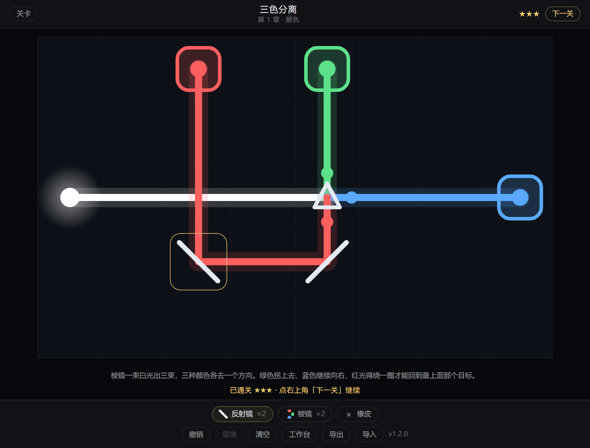

# 光的游戏 · light_game

[](https://github.com/xiaoxuhui/light_game/actions/workflows/test.yml)
[](LICENSE)

一个零运行时依赖、可离线运行的网格光路解谜游戏。

在线试玩：**https://xiaoxuhui.github.io/light_game/**

安卓版：**[下载 APK](https://github.com/xiaoxuhui/light_game/releases/latest)** —— Android 7.0 及以上，2.24 MB，不申请任何权限。



用反射镜、分光镜和棱镜引导光的方向与颜色，把正确颜色的光送到目标上。
无计时、无失败、无音效，摆弄光路本身就是奖励。

## 玩法

- **元件**：反射镜（转向）、分光镜（一分为二，透射 + 反射）、棱镜（把光按颜色拆成三束：
  红左转 90°、绿直行、蓝右转 90°，三态朝向决定哪个颜色走直行）。
- **颜色**：光在传输中保持颜色，在目标处按加色法合成 —— 红光 + 绿光 = 黄光。
  白光射入棱镜会分成红、绿、蓝三束，各走一个方向；把绿光和蓝光送到同一个目标，
  它就凑成了青色。目标是超集判定：白光含三种颜色，打在只要求单色的目标上也算点亮。
- **星级**：通关 1 星；元件数 ≤ `par + 2` 得 2 星；≤ `par` 得 3 星。
  `par` 是穷举验证过的最小元件数（`npm run verify:par`），用更少的元件解出来才能满星。
- **16 个关卡**，分三章：教学 4 关、颜色 6 关、精算 6 关。
  颜色章不发分光镜（反射镜无法分束），所以那一章必须用棱镜。

| 操作 | 鼠标 / 触摸 | 键盘 |
|---|---|---|
| 选中元件 | 点击底栏工具 | `1`–`3` |
| 选中橡皮 | 点击底栏橡皮 | `E` |
| 放置 | 点击空格 | 方向键移动光标 + `Enter` |
| 旋转（棱镜四向输入） | 点击已放置的元件 | `Enter` |
| 棱镜 RGB 出口换色 | 选中网格上的棱镜后点「棱镜换色」 | `C` |
| 删除 | 右键，或选中橡皮后点击 | `Delete` / `Backspace` |
| 撤销 / 重做 | 底栏按钮 | `Ctrl+Z` / `Ctrl+Shift+Z`（或 `Ctrl+Y`） |
| 关卡列表 / 取消选中 / 关浮层 | 顶栏「关卡」 | `Esc` |

布局会自动存档，另有「工作台」可以把当前布局存成具名快照。
「导出」把当前关卡存成 JSON 文件，「导入」可以把它再读回来。

### 自由模式（本地开发版，待发布）

顶部独立一行的「关卡模式｜自由模式」可随时来回切换，选中模式以金色显示。
自由模式使用可向任意方向平移的无限网格，支持负坐标。拖动画布或用「漫游」平移，
滚轮／「＋」「－」缩放，「回到起点」复位视野；手机元件栏可左右滑动。
可以放置反射镜、分光镜、棱镜、冷镜、热镜、墙壁、输出灯泡、四面光源、单向光源和芯片。
光源默认为白光，输出灯泡收到任意颜色的光就亮起。默认光源、墙与灯泡也可用橡皮（`E`）擦除后重放。
单向光源、芯片、IO 和棱镜输入面均为四向旋转，点击旋转。
棱镜输入面、箭头及三个 RGB 出口一起旋转，只接受当前输入面上的来光。
默认从左侧输入，依次旋转后改为从上、右、下侧输入；`C` 或「棱镜换色」单独切换三种 RGB 出口顺序。
热镜初始关闭挡光，侧面有光一拍后开启，无光一拍后关闭。冷镜本格默认带侧面非门：侧面有光一拍后关闭，无光一拍后开启；两者的通路光均不触发开关，持续侧面输入保持当前开关状态。
停止受光后逐步冷却并恢复初态。两者外观仍为横向／竖向两态，温度条显示升温、冷却过程。
两种模式各自自动保存布局；刷新后恢复上次模式和关卡，清空的自由布局也会保留。
「从关卡复制」重新载入关卡布局；「应用到关卡」仅带回原有三类镜片，并检查配额与坐标，通过后判定成绩。
原关卡的光源、目标与墙不受实验修改影响。复制与应用均可撤销，每关的自由实验互不覆盖。

### 自定义芯片

芯片内部只有一种 IO口，旧输入口、输出口和 IO 都沿用入口规则。箭头表示外到内：向下箭头从上方接入，内部光从它出去后向上；向右箭头从左方接入，出去后向左，其他方向类推。沿箭头行进的光进入内部，朝外侧行进的光输出，侧面挡光；端口不会把光束强行转弯。
端口只显示绿色箭头，不标“入／出”、不切换角色。点击一次转90°，两次转180°；旧存档保留每个箭头原本朝向。
自由模式顶部「芯片库」→「新建芯片」，直接进入独立的无限形状网格，不用填写矩形宽高。
点击任意格子翻转选中／取消；拖动平移，滚轮缩放，支持负坐标和任意跨度。「清空形状」和撤销可反复使用。
画好后点「下一步」，进入只包含已选方块的外层网格；点击任意方块，进入它独立的内部网格，四向 IO、旋转、冷热镜和嵌套芯片均沿用原规则。
名字可以在画形状时填写，也可以设计内部时或最后再取。
每格内部网格互相独立，内部元件坐标不受外层尺寸限制。点「保存并返回外层网格」编辑其他格，再保存返回实验板。
相邻格通过各自 IO 连接；外环格从对应位置收发外部信号，不把同方向来光广播给其他格。
在格子内部点「本格外观」，可设置这格的颜色、文字和绿色朝向箭头。
从芯片库选择「放置」，芯片按实际轮廓占多个格子，空洞可放置其他元件。点击任意身体格可旋转／删除，重叠时会阻止放置或旋转。
已有内部线路的格子需先清空，才可从轮廓移除；旧芯片保留原来的一格外壳与内部线路，可从芯片库的「形状」修改。
IO 只在芯片内部提供，只有上、右、下、左四种箭头方向，点击旋转。
从右边进入芯片的光匹配向左 IO，从下边进入匹配向上 IO；没有匹配入口时挡光。
匹配入口后按内部线路处理，内部墙壁和关闭的冷热镜及开关侧面仍会挡光，不会自动直通绕过。
所有端口箭头均指向内部，对外输出方向与箭头相反。要交换内外方向时点击两次旋转；旋转外部芯片会同时旋转入口匹配和输出方向。
芯片只显示一个默认向上的绿色朝向箭头，名字和箭头随芯片一起旋转；中键查看时显示实际收发状态。
芯片可使用内部光源独立输出，名称、内部布局与实例朝向均自动保存，实验板导出时包含完整芯片库。
芯片内部可放入其他芯片；直接或间接包含自身的循环嵌套会被拦截。
中键点击实验板上的芯片，查看该实例正在运行的内部光路、温度和灯泡状态，进入和返回不重置计时。
此视图只读，编辑定义仍从「芯片库」进入。中键点击其他位置或 Ctrl＋中键均无操作。
芯片库中每个芯片都有「删除」按钮，确认后同时移除所有实验板及工作台中的对应实例。
关闭芯片库前可点「撤销删除芯片」恢复。只想移除网格上的某一个实例时，用橡皮即可。

### 时间与快捷键

空格或顶部「暂停／开始」切换运行状态；在名称等文本框内输入空格不会触发暂停。
暂停后按 `N` 或点「单步（N）」仅推进一拍，完成后保持暂停；长按 N 不会连续推进。
每拍默认 0.5 秒，暂停期间时间、温度、延迟状态均冻结，可继续布置线路。
顶部「每拍」可设置 0.05–3600 秒，修改后立即生效并自动保存。冷热镜延迟均为一拍。
冷热镜是有朝向的通光开关：横镜仅上下通光，竖镜仅左右通光，侧面光不穿透。竖镜的上下两侧、横镜的左右两侧是控制输入，任一侧有光即视为有输入；热镜正向控制、冷镜反相控制，各自独立更新。旋转同时改变通路与侧面控制方向，斜光被挡。

| 操作或组件 | 时间规则 |
|---|---|
| 新放光源、光源方向／颜色变化 | 下一拍生效，变化前保留原输出 |
| 输出灯泡 | 下一拍响应接收到的光 |
| 热镜 | 侧面有光一拍开启，无光一拍关闭，通路光不触发 |
| 冷镜 | 本格侧面非门：侧面有光一拍关闭，无光一拍开启，通路光不触发 |
| 光传播、普通反射、分光、棱镜、墙 | 在当前拍即时计算，不随距离增加延迟 |
| 芯片 IO | 自身不耗时，按内部元件计算；不同实例各自保存运行状态 |

Ctrl＋左键在画布上将所有可旋转元件一起旋转，Ctrl＋右键删除当前板上所有可编辑元件。
批量操作各占一个撤销步骤，可以用 Ctrl＋Z 一次恢复。中键不再用于平移，拖动画布或「漫游」可平移。

## 路线图

| 阶段 | 内容 | 状态 |
|---|---|---|
| 一 | 电脑浏览器 Web 版（纯静态，无打包器） | ✅ 已完成 |
| 二 | 打包安卓 APK（WebView 外壳 + 内置资源 + 云端构建） | ✅ 已完成（最新 v1.2.1） |

阶段二复用了已在 EML 计算台、康威生命游戏上跑通的打包方案。工程结构从第一天起就按 APK
的约束设计（相对路径、不用 ES Module、Pointer Events、导出收敛到单一函数），所以打包没有返工：
全工程只有导出这一个出口需要在安卓端改走原生桥。

## 安卓版

从 [Releases](https://github.com/xiaoxuhui/light_game/releases) 下载 APK 直接安装即可，
首次安装需要在系统里允许「安装未知来源应用」。包内是同一份 Web 代码加一层 WebView 外壳，
离线可玩，界面与网页版完全一致。当前版本 **v1.2.1**（`versionCode 3`）。

> ⚠️ **仍在 1.1.0 的用户需要先卸载旧版**（升级到 1.2.0 或 1.2.1 都一样）。
> 1.1.0 的包是当年构建时由构建机自动生成的
> **随机签名**签发的，无法被新签名覆盖，系统会直接报「应用未安装」。
> 卸载会清空本地存档（星数、每关布局、工作台快照）。**从 1.2.0 起签名已固定**，
> 之后的版本都能直接覆盖升级，不会再遇到这个问题。

与浏览器相比，跨进程有差异的只有两处，都属于预期：

| 项 | 说明 |
|---|---|
| 导出 | WebView 不支持 `Blob` + `<a download>`，安卓端改由原生桥写系统下载目录，提示语为「已保存到…」 |
| 存档 | 页面跑在 `appassets.androidplatform.net` 的 https 域下，`localStorage` 的 origin 与网页版不同，安卓端存档从零开始 |

出包全程在 GitHub Actions 上云端构建，本地不需要安装 Android SDK。相关命令：

```bash
npm run sync:android    # 把 index.html / scripts / styles 同步进 android/app/src/main/assets
npm run check:android   # 只校验一致性、不写入（CI 用这个）
```

细节与取舍见 [`doc/安卓打包实施计划.md`](doc/安卓打包实施计划.md)。

## 本地运行

需要 Node.js 20.19 或更高版本。

```bash
npm ci            # 安装开发依赖（仅 eslint 与 Playwright，运行时零依赖）
npm run serve     # 启动静态服务，默认 http://127.0.0.1:4174
```

端口刻意避开 4173 —— 那个端口被同目录下的 conway-life-game 占用，
两个项目同时启动时 Playwright 会连错站点。需要改端口用 `PORT=5000 npm run serve`。

也可以直接双击 `index.html` 用 `file://` 打开，项目不依赖任何构建产物。

## 质量命令

```bash
npm run check         # JavaScript 语法检查
npm run lint          # ESLint 静态检查
npm test              # 单元测试 110 条（node --test）
npm run test:browser  # Playwright 验收 60 条（桌面 + 移动视口）
```

## 项目结构

```
index.html                     单页入口
styles/main.css                全部样式，主题变量集中在 :root
scripts/light-core.js          方向表、颜色掩码、反射与分光规则、元件规则表
scripts/light-engine.js        光路求解、目标判定、星级计算
scripts/levels.js              16 关数据 + schema 校验 + 外部关卡注册
scripts/renderer.js            把引擎输出画到 canvas（不含任何规则判定）
scripts/storage.js             存档、工作台快照、JSON 导入导出、downloadFile()
scripts/app.js                 编排：输入 → 引擎 → 渲染 → HUD → 存档
scripts/serve-static.js        零依赖本地静态服务（开发工具，非应用代码）
tests/                         单元测试（不需要浏览器）
e2e/                           Playwright 验收（真实浏览器 + 真实输入）
doc/                           需求与测试用例、设计文档、实施计划、安卓打包文档
android/                       安卓外壳工程（WebView + 内置 assets + 程序化图标）
scripts/sync-android-assets.mjs  把 Web 资源同步进 android 的 assets（开发工具）
.github/workflows/test.yml     CI：语法 + lint + 单测 + 浏览器验收
.github/workflows/android-apk.yml  CI：云端构建 APK，打 tag 时挂到 Release
```

脚本按 `<script defer>` 顺序加载，**加载顺序即依赖顺序**，与 `app.js` 共享全局命名空间。
前五个脚本用 UMD 包装：浏览器里挂到 `globalThis.LightXxx`，Node 单测通过 `module.exports`
拿到同一份实现。新增跨文件全局时记得同步 `eslint.config.js` 的 `crossScriptGlobals`。

分层红线：`light-core` / `light-engine` 不碰 DOM 与 canvas；`renderer` 不复制规则判定，
只读引擎给出的结果；`storage` 的变换函数一律返回新对象、不改入参。

## 设计约束

这些约束是为了让阶段二的 APK 打包不返工，请勿违反：

- **零运行时依赖**：不使用 npm 运行时包、不使用打包器、不请求 CDN。
- **相对路径引用资源**：绝对路径 `/xxx` 在安卓 WebView 里会解析到错误域名并 404 白屏。
- **不使用 `type="module"`**：`file://` 下会被 CORS 拦截；脚本按 `defer` 顺序加载。
- **不用 HTML5 拖放传交互**：安卓触摸端不触发 `dragover` / `drop`，需要 Pointer Events。
- **导出走可替换的下载函数**：WebView 不支持 `Blob` + `<a download>`，届时改由 JS 桥接管，
  所以所有导出都收敛到 `storage.downloadFile()` 这一个出口。

## 性能与规模上限

在 Chromium 1280×800 @ dpr 2 上实测（数值与结论见 `doc/需求与测试用例.md` 的 Q12 表）：

| 场景 | 求解 | 单帧绘制 |
|---|---|---|
| 内置关卡（最大 12×7） | < 0.005 ms | 0.02 ms |
| 极限关卡（40×40 / 998 元件 / 4096 光段） | 6.4 ms | 0.8 ms |

最坏情况仍在 60 fps 的单帧预算内。单次求解超过 4096 光段会停止追踪并给出警示，不冻结页面。

## 许可

[MIT](LICENSE) © 2026 xiaoxuhui

`R` 或顶部「重置（R）」将运行过程恢复到第 0 拍，保留布局及暂停状态。
